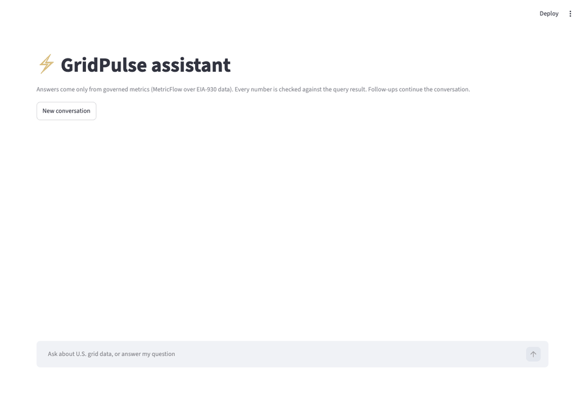
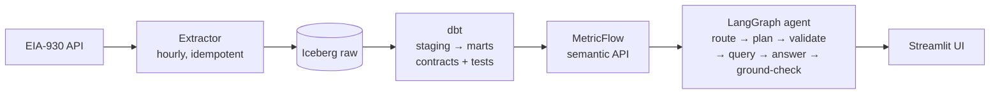

# GridPulse

Grid operations analytics platform: hourly U.S. electricity grid data (EIA-930) and NOAA weather, turned into governed metrics that analysts and an LLM assistant can query without writing SQL.

Runs fully offline on a laptop (SeaweedFS S3 + Lakekeeper Iceberg catalog + Trino) and on AWS (S3 + Glue + Athena + EKS), with one-command spin-up and tear-down for demos.

- Design and decisions: [`docs/blueprint.md`](docs/blueprint.md)
- Progress: [`docs/STATUS.md`](docs/STATUS.md)
- Architecture decision records: [`docs/adr/`](docs/adr/)

## MVP: what works today





The same code runs in two places: **locally** (SeaweedFS + Lakekeeper + Trino, Airflow 3 scheduling)
and on **AWS** (S3 + Glue + Athena, EKS for the APIs, created and destroyed with `make aws-up` /
`make aws-down`). Engine differences live in dbt macros, never in forked code.

| What | Evidence |
|---|---|
| Ingestion is idempotent | Rerunning a window adds no new distinct rows; completeness check passes |
| Incremental models are correct | Incremental build equals a full rebuild row for row; DST and A → B → A revision cases unit-tested |
| Both engines agree | Trino and Athena return identical row counts and values for July 2026 |
| Metrics match hand-written SQL | Each governed metric equals its reference SQL query (relative tolerance 1e-9) |
| The agent picks the right metric | Golden set of 17 questions: 17/17 (100%) on the latest run, target ≥ 90% |
| Wrong numbers never reach the user | Every number in an answer must appear in the query result; an injected wrong figure triggers a rewrite, then falls back to the raw table |
| Deployed demo works | Smoke test: PJM demand for July 2026 is 85,612,424 MWh from the semantic API on EKS and from an independent Athena query |

The agent never writes SQL: it produces a metric request, which is validated in code and compiled
by MetricFlow. Data: six sample balancing authorities (CISO, ERCO, ISNE, MISO, NYIS, PJM),
July–October 2026.

> **Temporary:** the assistant is designed to run on Claude via Amazon Bedrock. Until AWS lifts this
> new account's Bedrock quota, local development uses the OpenAI API with a budget-capped key that
> never leaves the laptop ([ADR-0003](docs/adr/0003-temporary-openai-provider-for-local-development.md)).

### Still to come (Phase B)
- **Data coverage:** generation by fuel, interchange, NOAA weather, quality flags, revision history, snapshots, reconciliation
- **Orchestration on Kubernetes:** Airflow 3 on k3d and EKS with KubernetesExecutor and Cosmos, alerts, a full historical backfill on AWS
- **Full semantic layer:** 12 metrics including coincident peak, saved queries
- **Full agent:** clarifying questions, multi-turn memory (Postgres checkpointer), a 50-question golden set with a nightly eval
- **CI/CD:** slim CI, Terraform plan comments, gated deploys with rollback
- **Polish:** dbt docs site, cost report, write-up of the data issues found

## Quick start

```bash
make setup   # install pinned tools and git hooks
make lint test
make help    # all commands

make up-lake           # local lake: Trino at http://localhost:8080, catalog UI at http://localhost:8181/ui
make test-integration  # prove Trino can write and read Iceberg tables, and reruns are idempotent
make extract-sample START=2026-10-01 END=2026-10-08   # load a week of EIA data for 6 sample BAs (needs EIA_API_KEY in .env)
make dbt-build         # build and test the dbt models (staging → intermediate → marts) on the local lake
make up-orch           # lake + Airflow 3 (http://localhost:8088): hourly extract → dbt build → cache refresh
make dbt-docs          # browse model docs and lineage at http://localhost:8081
make semantic-api      # governed metrics over HTTP: http://localhost:8090/docs
make mf ARGS="query --metrics demand --group-by balancing_authority"   # MetricFlow CLI
make agent-api         # the assistant (LangGraph; model provider set in .env): http://localhost:8091/docs
make agent-ui          # Streamlit demo UI
make agent-eval        # golden-set accuracy (target ≥ 90%)
make demo-gif          # re-record docs/assets/demo.gif from the running UI
make aws-up            # AWS demo on EKS with a smoke test (~15–20 min); `make aws-down` removes it
make down              # stop (keeps data); `make reset` wipes it
```

## Data credits
Grid data: U.S. Energy Information Administration (EIA), used under EIA's copyright and reuse policy and API terms of service. Weather: NOAA Global Hourly (ISD), public domain.
