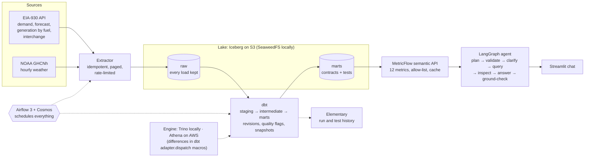

# GridPulse

Hourly U.S. electricity grid data (EIA-930) and NOAA weather, turned into governed metrics that
analysts and an LLM assistant can query without writing SQL.

The same code runs **offline on a laptop** (SeaweedFS S3 + Lakekeeper Iceberg catalog + Trino,
Airflow 3) and **on AWS** (S3 + Glue + Athena, EKS for the APIs), with one command to create the
cloud demo and one to destroy it.

**▶ [Two-minute video tour](https://debolai.github.io/gridpulse/)** ·
[dbt docs](https://debolai.github.io/gridpulse/dbt/) ·
[Elementary report](https://debolai.github.io/gridpulse/elementary/) ·
[Design](docs/blueprint.md) · [Decisions (ADRs)](docs/adr/README.md) · [Progress](docs/STATUS.md)


## Try it (no accounts, no keys)

Needs Docker (14-16 GB memory for Docker Desktop), [uv](https://docs.astral.sh/uv/) and `make`.

```bash
git clone https://github.com/debolai/gridpulse.git && cd gridpulse
make setup   # pinned Python tools and git hooks
make up      # lake + Airflow; an empty lake gets the committed sample (2 weeks, 6 BAs) and a dbt build
make semantic-api   # governed metrics over HTTP: http://localhost:8090/docs
```

```bash
curl -s localhost:8090/query -H 'content-type: application/json' -d '{"metrics": ["demand"],
  "group_by": ["balancing_authority"], "start": "2026-10-01T00:00:00Z", "end": "2026-10-08T00:00:00Z"}'
```

Airflow is at http://localhost:8088 and Trino at http://localhost:8080. Without keys, the DAGs
that need one start paused. Copy `.env.example` to `.env` to add an EIA key (live extraction) or a
model provider (the assistant: `make agent-api`, then `make agent-ui`). `make down` stops
everything and keeps the data; `make help` lists every command.

## Architecture



- **The agent never writes SQL.** It produces a metric request (metrics, dimensions, filters,
  window) that is validated in code and compiled by MetricFlow. Every number in the answer must
  appear in the query result, or the answer is rewritten, then replaced by the raw table.
- **Store UTC, derive local time** per balancing authority (BA). Interchange is positive for
  exports. Ratios are ratios of sums. Bad values are flagged, never deleted.
- **Two runtimes, one codebase.** The laptop runs Trino on Iceberg with Airflow on Docker or k3d;
  AWS runs Athena v3 on the Glue catalog with the APIs on EKS. `make aws-up` / `make aws-down`
  create and destroy the cloud compute; only storage stays up between demos.

## Evidence

| Claim | How it is checked |
|---|---|
| Ingestion is idempotent | Rerunning a window adds no new distinct rows; EIA revisions are kept as new versions, and `fct_data_revisions` shows the real ones |
| Incremental models are correct | Incremental build equals a full rebuild row for row (also a scheduled DAG); DST and A → B → A revisions are unit-tested |
| Both engines agree | Trino and Athena returned identical values for July 2026, checked for each mart and metric as it was built |
| Metrics match hand-written SQL | Integration suite: each governed metric equals its reference query (relative tolerance 1e-9), in CI on every PR |
| The agent picks the right metric | 53-question golden set: planner 98%, end to end 100% (nightly DAG, scores in Postgres) |
| It asks instead of guessing | "California" means one BA or five; the agent asks, and 3 golden cases check it doesn't ask when the question is clear |
| Wrong numbers never reach the user | An injected wrong figure triggers a rewrite, then a fallback to the raw table |
| A real data issue was caught | EIA's regional totals arrived as BAs and would have tripled U.S. demand; `relationships` tests stopped the build ([write-up](docs/data-issues/eia-aggregate-respondents.md)) |
| Deploys are safe | CD deploys a SHA-tagged image after approval, smoke-tests it (PJM July 2026 = 85,612,424 MWh from the API and from Athena), and rolls back on failure; both rollback paths were proven live |
| It is cheap | Idle about $0.10-1 a month; demo about $0.20-0.25 an hour; $0.52 spent this month, one-year backfill included ([cost report](docs/cost-report.md)) |

CI on every PR (all required on `main`): gitleaks, ruff/yamllint/sqlfluff/hadolint, 172 unit
tests, every image built and smoke-tested, DAG integrity on both runtimes, the full dbt build and
integration suite on a fresh local lake, Terraform validate/tflint/checkov, a plan comment, and
dbt slim CI on Athena. AWS access from GitHub uses OIDC roles, with no stored keys.

> **Temporary:** the assistant is designed to run on Claude via Amazon Bedrock. Until AWS lifts
> this new account's Bedrock quota, local development uses the OpenAI API with a budget-capped
> key that never leaves the laptop
> ([ADR-0003](docs/adr/0003-temporary-openai-provider-for-local-development.md)).

## Repository

| Path | What |
|---|---|
| `ingestion/` | EIA and NOAA extractors, Iceberg sink, the committed-sample tool |
| `transform/` | dbt project: models, tests, seeds, snapshots, semantic models and metrics |
| `semantic/` | FastAPI service over MetricFlow |
| `agent/` | LangGraph agent, API, Streamlit UI, golden set and evals |
| `orchestration/` | Airflow DAGs (Docker and Kubernetes runtimes) |
| `infra/` | Terraform (foundation + compute stacks), Helm chart, deploy scripts |
| `local/` | Docker Compose stack, k3d config, the CI sample |
| `docs/` | Blueprint, ADRs, status, cost report, data-issue write-up |

## Data credits

Grid data: U.S. Energy Information Administration (EIA), used under EIA's copyright and reuse
policy and API terms of service. Weather: NOAA Global Historical Climatology Network hourly
(GHCNh), public domain.
